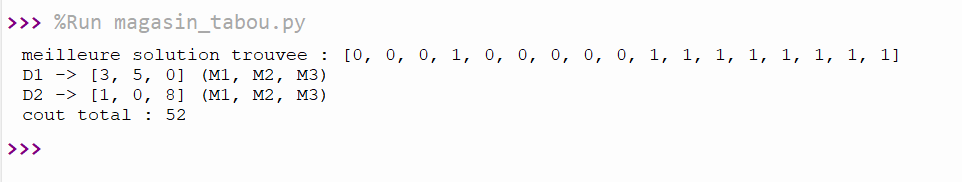
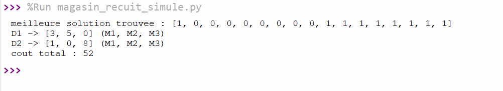
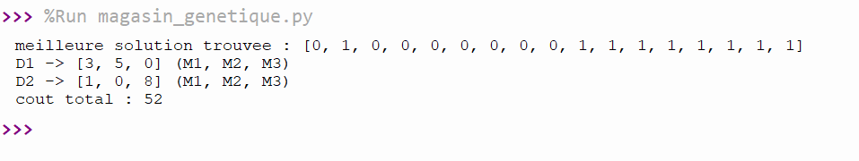

# Livraison de containers : tabou, recuit simulé et algorithme génétique

Ce dossier contient trois solutions au même problème de transport de containers.

## Le problème

Une entreprise a 2 dépôts (D1 et D2) qui contiennent des containers. 3 magasins (M1, M2, M3) commandent des containers. On connaît le coût de transport d'un container de chaque dépôt vers chaque magasin :

| | M1 | M2 | M3 | Stock du dépôt |
|----|----|----|----|----------------|
| D1 | 5  | 3  | 4  | 8              |
| D2 | 6  | 7  | 2  | 9              |

Demandes des magasins : M1 = 4, M2 = 5, M3 = 8 containers.

**Objectif** : trouver l'organisation des livraisons qui **minimise le coût total de transport**.

## Modèle en programmation linéaire en nombres entiers

`x_ij` = nombre de containers livrés du dépôt Di au magasin Mj.

```
Minimiser   somme des c_ij * x_ij
Sous les contraintes :
    x_i1 + x_i2 + x_i3 = stock de Di      (i = 1, 2)
    x_1j + x_2j        = demande de Mj    (j = 1, 2, 3)
    x_ij entier et >= 0
```

Ici le stock total (8 + 9 = 17) est égal à la demande totale (4 + 5 + 8 = 17).

## Encodage (commun aux trois méthodes)

Chaque container demandé est numéroté. On a 17 containers : 4 pour M1, 5 pour M2 et 8 pour M3. Une solution est une liste de 17 valeurs : `solution[k]` est le dépôt (0 pour D1, 1 pour D2) qui livre le container `k`.

Exemple : `[0, 0, 1, 0, 0, 0, 0, 0, 0, 1, 1, 1, 1, 1, 1, 1, 1]`

- La liste contient toujours 8 zéros (D1) et 9 uns (D2), donc les stocks sont toujours respectés.
- Chaque magasin reçoit exactement sa demande, par construction.

## Fonction objectif (commune)

La fonction `calculate_cout(solution, couts)` additionne le coût de transport de chaque container (du dépôt qui le livre vers son magasin). Plus le coût est **petit**, meilleure est la solution.

La fonction `affiche_livraison(solution)` affiche le tableau des livraisons (nombre de containers de chaque dépôt vers chaque magasin).

## Les fichiers

| Fichier | Méthode |
|---------|---------|
| `containers_tabou.py` | Recherche tabou |
| `containers_recuit_simule.py` | Recuit simulé |
| `containers_genetique.py` | Algorithme génétique |

### 1. Recherche tabou (`containers_tabou.py`)

On travaille avec **une seule solution**.

- Un voisin s'obtient en échangeant un container de D1 avec un container de D2.
- À chaque itération, on évalue tous les voisins et on se déplace vers le meilleur, même s'il est moins bon.
- La liste tabou garde les derniers mouvements pour interdire de les annuler. Un mouvement tabou est permis s'il bat la meilleure solution trouvée (critère d'aspiration).
- Paramètres : `tabou_length` (taille de la liste tabou) et `max_iter` (nombre d'itérations).

### 2. Recuit simulé (`containers_recuit_simule.py`)

On travaille avec **une seule solution**.

- Un voisin s'obtient en échangeant un container de D1 avec un container de D2 (au hasard).
- Si le coût diminue, on accepte le voisin. Sinon, on l'accepte avec la probabilité `exp(-différence / température)`.
- La température baisse à chaque palier (`température = température * alpha`).
- Paramètres : `temperature`, `temperature_min`, `alpha`, `nombre_essai`.

### 3. Algorithme génétique (`containers_genetique.py`)

On travaille avec une **population** de solutions (20 individus, 50 générations).

- **Croisement** : on échange la fin de deux parents à un point de coupure. Comme le nombre de containers de D1 peut changer, la fonction `reparer` corrige l'enfant pour retrouver 8 containers de D1 et 9 de D2.
- **Mutation** : on échange un container de D1 avec un container de D2.
- **Sélection** : on garde les 20 individus avec le coût le plus petit.
- Paramètres : `nombre_individu`, `max_generation`.

## Exécution

Il faut Python 3 (aucune bibliothèque externe). Dans le dossier :

```
python containers_tabou.py
python containers_recuit_simule.py
python containers_genetique.py
```

Chaque programme affiche la meilleure solution, le tableau des livraisons et le coût total.

## Captures d'exécution

### Recherche tabou



### Recuit simulé



### Algorithme génétique



## Résultat attendu

La solution optimale (vérifiée par énumération de toutes les possibilités) a un coût total de **52** :

| | M1 | M2 | M3 |
|----|----|----|----|
| D1 | 3  | 5  | 0  |
| D2 | 1  | 0  | 8  |

Coût : 3×5 + 5×3 + 0×4 + 1×6 + 0×7 + 8×2 = 15 + 15 + 0 + 6 + 0 + 16 = 52.

Dans nos essais, les trois méthodes trouvent ce coût.

## Remarques

- Ces méthodes utilisent le hasard, donc les résultats peuvent changer d'une exécution à l'autre. Il est conseillé de lancer chaque programme plusieurs fois.
- Le programme suppose 2 dépôts et que le stock total est égal à la demande totale (comme dans l'énoncé).
- Il faut essayer plusieurs valeurs des paramètres plutôt que de se limiter à une seule.
