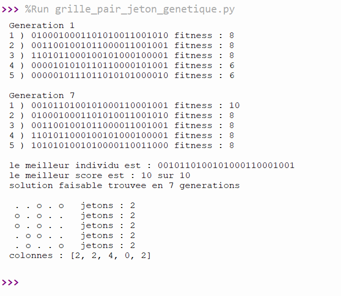

# Placement de jetons sur une grille : algorithme génétique

Ce dossier contient la solution du problème des jetons avec un algorithme génétique, dans le même style que la cédule de maintenance.

## Le problème

Sur une grille de `n` lignes et `n` colonnes, on veut placer `k` jetons (`k < n²`) de sorte que **chaque ligne et chaque colonne contienne un nombre pair de jetons**. Exemple : `n = 5` et `k = 10`.

- Solution faisable : toutes les lignes et toutes les colonnes ont un nombre pair de jetons (0, 2 ou 4).
- Solution non faisable : au moins une ligne ou une colonne a un nombre impair de jetons.

Remarque : la somme des jetons de toutes les lignes est `k`. Si chaque ligne est paire, `k` est pair. Donc si `k` est impair, il n'y a pas de solution (le programme le vérifie).

## 1. Taille de l'espace de recherche

Une solution est le choix de `k` cases parmi les `n²` cases de la grille :

```
Taille = C(n², k) = n² ! / ( k ! (n² - k) ! )
```

Pour `n = 5` et `k = 10` : `C(25, 10) = 3 268 760` solutions possibles.

Parmi elles, 12 840 sont faisables (comptées par énumération), soit environ 0,4 %.

Si on ne fixe pas le nombre de jetons (une case = un bit, donc `n²` bits), l'espace est plus grand : `2^25 = 33 554 432`.

## 2. a) Codage des solutions

Un individu est une liste de `n × n = 25` bits : `1` = jeton, `0` = case vide. Les cases sont lues ligne par ligne.

Exemple : `0010111101011001010000000` correspond à la grille

```
 . . o . o
 o o o . o
 . o o . .
 o . o . .
 . . . . .
```

Un individu contient toujours exactement `k` jetons : la création, le croisement (avec la fonction `reparer`) et la mutation gardent ce nombre.

## 2. b) Fonction fitness

On compte les lignes et les colonnes qui ont un nombre **impair** de jetons :

```
fitness = 2n - (nombre de lignes impaires + nombre de colonnes impaires)
```

- Plus la fitness est grande, meilleur est l'individu.
- Une solution faisable a la fitness maximale `2n` (10 pour `n = 5`).

## 2. c) Code complet

Fichier : `jetons_genetique.py`

| Fonction | Rôle |
|----------|------|
| `creation_individu` / `createGeneration` | créent un individu (k jetons au hasard) et la première génération (50 individus) |
| `fitness` | calcule le score d'un individu |
| `croisement_point` | échange la fin de deux parents à un point de coupure situé entre deux lignes |
| `reparer` | après un croisement, enlève ou ajoute des jetons pour retrouver exactement `k` jetons |
| `mutation` | déplace un jeton vers une case vide |
| `developpement_generation` | ajoute 20 enfants (10 croisements) et 20 mutations |
| `selection` | garde les 50 meilleurs |
| `afficheGeneration` / `afficheGrille` | affichent les 5 meilleurs individus et la grille de la solution |

Le programme s'arrête quand une solution faisable est trouvée, ou après 300 générations.

Paramètres : `n`, `k`, `nombre_individu`, `max_generation`.

## Exécution

Il faut Python 3 (aucune bibliothèque externe) :

```
python jetons_genetique.py
```

Le programme affiche les meilleurs individus, le score, le nombre de générations et la grille avec le nombre de jetons de chaque ligne et colonne.

## Captures d'exécution




## Remarques

- Ces méthodes utilisent le hasard : la grille trouvée change d'une exécution à l'autre, car il y a plusieurs solutions.
- Pour d'autres valeurs de `n` et `k`, il suffit de changer les deux premières lignes du programme (avec `k` pair).
