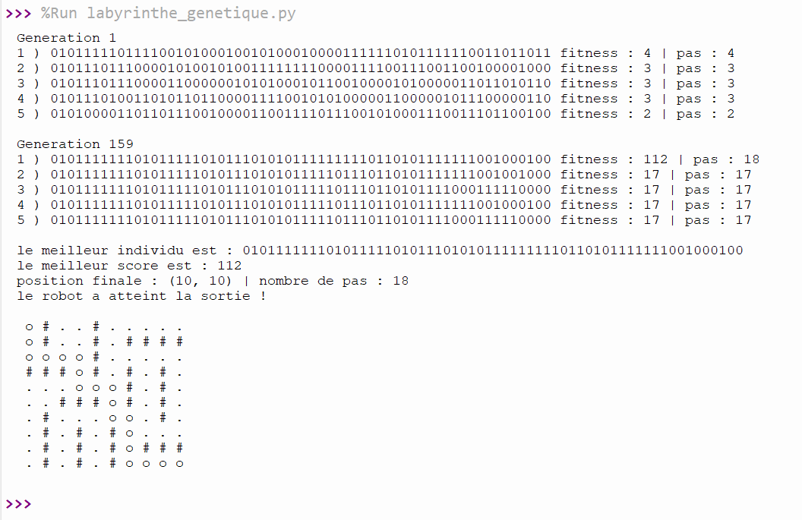

# Robot dans un labyrinthe : algorithme génétique

Ce dossier contient la solution du problème du labyrinthe avec un algorithme génétique, dans le même style que la cédule de maintenance.

## Le problème

Un robot se déplace dans un labyrinthe de 10 × 10 cases. Il s'arrête dès qu'il :

- se cogne contre un mur (case tramée) ou sort du labyrinthe,
- revient sur une case qu'il a déjà visitée,
- atteint la sortie.

L'entrée est la case (1,1) en haut à gauche et la sortie est la case (10,10) en bas à droite. **Objectif** : trouver un parcours qui mène à la sortie.

## Le labyrinthe

Le labyrinthe est lu à partir de la figure (`#` = mur, `.` = case libre) :

```
     1 2 3 4 5 6 7 8 9 10
 1   . # . . # . . . . .
 2   . # . . # . # # # #
 3   . . . . # . . . . .
 4   # # # . # . # . # .
 5   . . . . . . # . # .
 6   . . # # # . # . # .
 7   . # . . . . . . # .
 8   . # . # . # . . . .
 9   . # . # . # . # # #
10   . # . # . # . . . .
```

Dans le programme, c'est la liste `labyrinthe` : `0` = case libre et `1` = mur. Si votre figure est différente, il suffit de corriger cette liste.

## 1. Codage des individus

Un individu est une suite de **30 déplacements**. Chaque déplacement est un gène de 2 bits :

| Gène | Déplacement |
|------|-------------|
| `00` | haut        |
| `01` | bas         |
| `10` | gauche      |
| `11` | droite      |

Exemple : `01 01 11 11 11 01 ...` veut dire bas, bas, droite, droite, droite, bas, etc.

Le robot suit les déplacements dans l'ordre (fonction `parcours`) et s'arrête dès qu'un des cas du problème se produit. Les gènes qui restent après l'arrêt ne servent à rien.

## 2. Fonction fitness

La fonction `fitness(individu)` donne un score : plus il est **grand**, meilleur est l'individu.

- Si le robot atteint la sortie : `100 + (30 - nombre de pas)`. Le score est toujours plus grand que les autres, et un chemin plus court est meilleur.
- Sinon : `18 - distance réelle de la case finale à la sortie`. La distance est calculée une seule fois au début (`calcul_distances`), en partant de la sortie et en avançant case par case en tenant compte des murs. Le chiffre 18 est la distance entre l'entrée et la sortie.

On utilise la distance réelle (et non la distance en ligne droite) parce que, dans un labyrinthe, une case proche de la sortie en ligne droite peut être dans une impasse.

## 3. Opérateur de mutation

La fonction `mutation(individu, position)` remplace le déplacement à la position choisie par un autre déplacement pris au hasard. Un gène complet de 2 bits est remplacé, donc l'individu reste toujours valide.

La position est choisie parmi les déplacements que le robot a exécutés, plus celui qui l'a arrêté. Muter un gène après l'arrêt ne changerait rien au parcours.

## 4. Code complet

Fichier : `labyrinthe_genetique.py`

| Fonction | Rôle |
|----------|------|
| `creation_individu` / `createGeneration` | créent un individu et la première génération (100 individus) |
| `parcours` | fait avancer le robot et dit où et pourquoi il s'arrête |
| `fitness` | calcule le score d'un individu |
| `croisement_point` | échange la fin de deux parents à un point de coupure (sur des gènes entiers) |
| `mutation` | change un déplacement |
| `developpement_generation` | ajoute 20 enfants (10 croisements), 20 mutations et 5 nouveaux individus au hasard |
| `selection` | garde les 100 meilleurs |
| `afficheGeneration` / `afficheChemin` | affichent les 5 meilleurs individus et le chemin du robot |

Le programme s'arrête quand la sortie est trouvée, ou après 500 générations.

Paramètres : `nombre_individu`, `max_generation`, `nombre_genes`.


Le programme affiche les meilleurs individus, la position finale, le nombre de pas et le chemin dans le labyrinthe (`o` = case parcourue).

## Captures d'exécution



## Remarques

- Ces méthodes utilisent le hasard. Quand le programme répond « le robot n'a pas atteint la sortie », la population est restée bloquée sur un chemin sans issue : il suffit de relancer.
- Il faut essayer plusieurs valeurs des paramètres plutôt que de se limiter à une seule.
