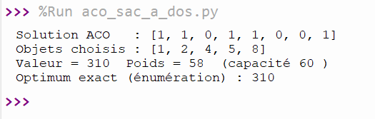

# Exercice 4 : Sac à dos résolu par colonie de fourmis (ACO)

## Énoncé

On se propose de résoudre le problème du **sac-à-dos classique** (n objets `O_i` ; de valeurs respectives `V_i` ; de poids respectifs `p_i`, i = 1..n ; capacité du sac : `C`) en utilisant un **algorithme de colonie de fourmis**.

1. Donner une représentation binaire d'une solution puis calculer le nombre de solutions candidates.
2. Écrire la formulation mathématique du problème.
3. Combien de fourmis aura-t-on besoin ? Que devrait faire chaque agent « fourmi » et comment ?
4. Proposer une distance entre objets.
5. Écrire l'algorithme de colonie de fourmis résolvant ce problème.

---

## Correction

### Rappel théorique

Les algorithmes de colonie de fourmis (ACO) s'inspirent du comportement des fourmis, qui trouvent le plus court chemin grâce à la **phéromone** déposée sur leur trajet.

- **Construction** : chaque fourmi artificielle construit une solution pas à pas, avec des choix probabilistes.
- **Renforcement** : les bonnes solutions reçoivent plus de phéromone et attirent davantage les fourmis suivantes.
- **Évaporation** : la phéromone diminue avec le temps, ce qui évite de rester bloqué sur de mauvaises solutions.

### Question 1 : représentation binaire et nombre de solutions

Une solution est un vecteur binaire de longueur n :

```
s = (s1, s2, ..., sn),   s_i = 1 si l'objet O_i est dans le sac, 0 sinon
```

Exemple (n = 5) : `s = (1,0,1,1,0)` signifie que le sac contient O1, O3 et O4.

Chaque objet a 2 états indépendants, donc le nombre de solutions candidates est **2ⁿ** (par exemple 1 024 pour n = 10). Seules certaines sont **réalisables** (poids total ≤ C). Cette croissance exponentielle interdit l'énumération exhaustive et justifie l'emploi d'une métaheuristique.

### Question 2 : formulation mathématique

```
max  Z(s) = Σ_{i=1..n} V_i · s_i

s.c. Σ_{i=1..n} p_i · s_i ≤ C
     s_i ∈ {0, 1},   i = 1..n
```

C'est un problème d'optimisation combinatoire NP-difficile.

### Question 3 : nombre de fourmis, rôle et comportement

**Nombre de fourmis.** Le nombre `m` est un paramètre de l'algorithme. On prend souvent `m = n` (une fourmi démarre sur chaque objet), ou un `m` fixe plus petit (10 à 50). Une itération produit `m` solutions.

**Rôle de chaque fourmi.** Elle construit **une solution complète et réalisable**, puis dépose de la phéromone proportionnellement à la qualité de cette solution.

**Comment elle procède :**

1. **Départ** : sac vide (W = 0, Z = 0). Elle choisit un premier objet, au hasard ou imposé.
2. **Candidats** : seuls les objets non encore pris et qui rentrent (`W + p_j ≤ C`) sont considérés.
3. **Choix probabiliste** de l'objet j :

```
P_j = (τ_j)^α · (η_j)^β / Σ_{k ∈ candidats} (τ_k)^α · (η_k)^β
```

   - `τ_j` : phéromone sur l'objet j
   - `η_j = V_j / p_j` : visibilité (rentabilité) de l'objet
   - `α`, `β` : poids de la phéromone et de l'heuristique
4. **Mise à jour du sac** : `W ← W + p_j`, `Z ← Z + V_j`.
5. **Arrêt** : quand la liste des candidats est vide.

**Mise à jour de la phéromone** (après le passage de toutes les fourmis) :

- Évaporation : `τ_j ← (1 - ρ) · τ_j`, avec `ρ ∈ ]0,1[`
- Dépôt : pour chaque fourmi k et chaque objet j pris, `τ_j ← τ_j + Q · Z_k / Z_ref`

### Question 4 : distance entre objets

Le sac à dos n'a pas de distance géométrique naturelle. Deux propositions :

- **Proposition 1** (utilisée dans le code) : `d(i,j) = p_j / V_j`. Elle est petite pour un bon objet. La visibilité est son inverse : `η_ij = V_j / p_j`. Ce n'est pas une distance au sens strict (non symétrique), mais elle convient à la règle de transition.
- **Proposition 2** : `d(i,j) = | V_i/p_i - V_j/p_j |`, l'écart de rentabilité. Elle est symétrique et vérifie l'inégalité triangulaire. Variante euclidienne dans le plan (V, p) après normalisation.

### Question 5 : algorithme

```
Algorithme ACO_SacADos
Paramètres : m, Tmax, α, β, ρ, Q       Données : V[1..n], p[1..n], C
Début
  Pour j de 1 à n faire τ[j] <- τ0 ; η[j] <- V[j] / p[j]
  meilleureSol <- (0,...,0) ; meilleureVal <- 0

  Pour t de 1 à Tmax faire
      // Construction
      Pour chaque fourmi k de 1 à m faire
          s_k <- (0,...,0) ; W <- 0
          Candidats <- { j : p[j] <= C }
          Tant que Candidats ≠ ∅ faire
              Choisir j dans Candidats avec la probabilité P_j
              s_k[j] <- 1 ; W <- W + p[j]
              Candidats <- { l ∈ Candidats : l ≠ j et W + p[l] <= C }
          Fin Tant que
          Z_k <- Σ V[j]·s_k[j]
          Si Z_k > meilleureVal alors meilleureVal <- Z_k ; meilleureSol <- s_k
      Fin Pour

      // Phéromone
      Pour j de 1 à n faire τ[j] <- (1 - ρ)·τ[j]
      Pour chaque fourmi k, pour chaque j tel que s_k[j] = 1 faire
          τ[j] <- τ[j] + Q·Z_k / meilleureVal
  Fin Pour
  Retourner meilleureSol, meilleureVal
Fin
```

**Complexité** : O(Tmax · m · n²).

**Rôle des paramètres** : un `α` grand favorise l'exploitation de l'expérience, un `β` grand rapproche l'algorithme d'un glouton sur V/p, un `ρ` grand favorise l'exploration.

---

## Code

[`aco_sac_a_dos.py`](aco_sac_a_dos.py) implémente l'algorithme avec des boucles simples, puis vérifie le résultat en énumérant les 2ⁿ solutions.

